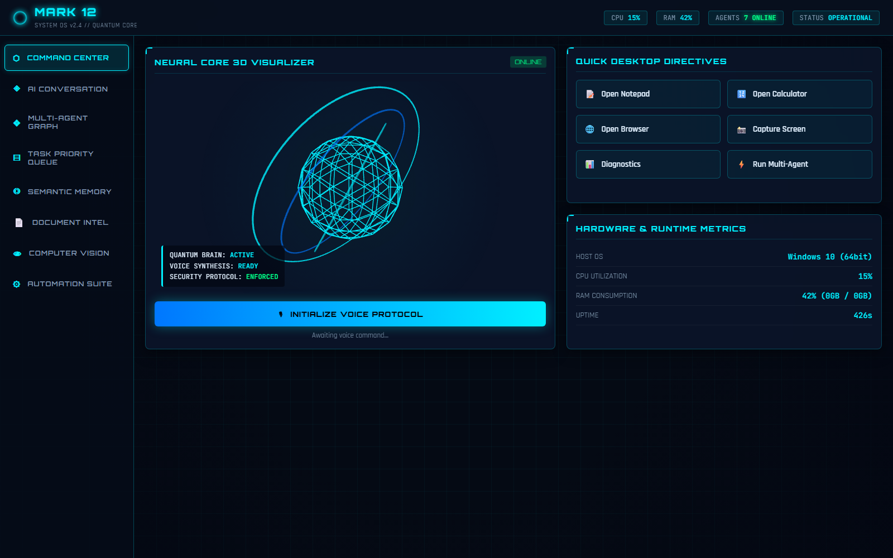

# ⚡ MARK 12 – AI Personal Life Assistant ⚡

> Advanced Multimodal Personal AI Operating System featuring Voice & Text Interaction, Semantic Memory, Computer Automation, Multi-Agent Collaboration, and Futuristic Holographic HUD.



---

## 🖼️ System Interface & Visualizer

Here is the live capture of the **MARK 12 Command Center** with its 3D Neural Core Visualizer, Hardware Telemetry Gauges, Quick Directives Matrix, and Navigation Suite:


---

## 🌟 Key Features

1. **Voice Assistant**: Natural voice interaction, wake word detection ("Jarvis"), and real-time neural speech synthesis.
2. **AI Conversational Brain**: Seamless multi-provider support (Offline Smart Brain, Google Gemini, OpenAI GPT-4o, and local Ollama Llama-3).
3. **Persistent Semantic Memory**: Hybrid retrieval leveraging ChromaDB / Dense Vector Embeddings + SQLite persistent storage.
4. **Desktop Automation**: Whitelist-verified system automation (open applications, web searching, process telemetry, screenshot captures).
5. **Multi-Agent Collaboration**: Directed Acyclic Graph (DAG) workflow connecting specialized agents:
   - **Planner Agent**: Decomposes complex objectives into executable DAG stages.
   - **Research Agent**: Synthesizes market & technical comparisons.
   - **Coding Agent**: Generates, debugs, and explains code.
   - **Document Agent**: Ingests, chunks, and summarizes documents.
   - **Vision Agent**: Optical entity and face detection.
   - **Personal Agent**: Priority queue scheduling, reminders, and daily life briefings.
   - **Automation Agent**: Executes verified system operations safely.
6. **Task Priority Queue & Tree Hierarchy**: Tasks scheduled using `heapq` Priority Queue and hierarchical Parent-Child Tree traversal.
7. **Document Intelligence (RAG)**: Universal loader for PDF, DOCX, and TXT with chunking and grounded semantic Q&A.
8. **Futuristic 3D Web Dashboard**: Three.js 3D Holographic Arc Reactor, audio-reactive HUD waveforms, live telemetry gauges, and glassmorphic panels.

---

## 🏛️ System Architecture

```
MARK_12/
├── backend/
│   ├── main.py                  # Master FastAPI & HTTP Server
│   ├── config.py                # Environment & storage settings
│   ├── dependencies.py          # Session and assistant injection
│   ├── api/                     # REST API routers (chat, voice, tasks, memory, files, vision, etc.)
│   ├── middleware/              # Auth, rate limiting, error handling
│   ├── websocket/               # Real-time WebSocket connection manager
│   └── static/                  # Futuristic 3D Holographic Web Dashboard (HTML/CSS/JS)
│
├── core/
│   ├── assistant.py             # Master programmatic facade
│   ├── brain.py                 # Central cognitive routing engine
│   ├── orchestrator.py          # Subsystems coordinator
│   ├── context_manager.py       # List, Stack (Undo), HashMap, Set data structures
│   ├── command_parser.py        # O(1) Dictionary command dispatcher
│   ├── intent_classifier.py     # Intent categorization
│   ├── personality.py           # Speech and persona styling
│   └── safety_manager.py        # Destructive command mitigation
│
├── ai_engine/
│   ├── llm/                     # Model Manager, Ollama, Gemini/OpenAI API clients
│   ├── speech/                  # STT, TTS, Wake Word, Audio FIFO Queue
│   ├── vision/                  # Image Analyzer, Webcam, Object Detector
│   ├── memory/                  # Short-term, Long-term, Vector Memory, Summarizer
│   └── embeddings/              # Dense feature vector embedding manager
│
├── agents/                      # Multi-Agent Graph & Specialist Agents
├── automation/                  # Desktop apps, browser, filesystem, processes, monitor
├── task_manager/                # Priority Queue (heapq), Task Tree, Scheduler, Reminders
├── document_engine/             # PDF, DOCX, TXT readers, Chunker, RAG QA
├── database/                    # SQLite connection, repository, models, and migrations
├── frontend/                    # Complete React 18 + TypeScript source code
├── storage/                     # Uploads, documents, images, audio, generated_code
├── tests/                       # Complete unit and integration test suite
└── scripts/                     # Launch, setup, and admin scripts
```

---

## 🧠 Core Data Structures Implemented

| Data Structure | Where Used | Why |
| :--- | :--- | :--- |
| **Dictionary** | Commands & Intents | Fast O(1) key-value lookup |
| **List** | Conversation History | Maintains sequential order |
| **Queue** | Voice Command Stream | Thread-safe FIFO audio processing |
| **Stack** | Undo Operations | LIFO reversal of actions |
| **HashMap** | User Preferences | Instant O(1) configuration access |
| **Priority Queue** | Task Scheduler | O(log N) scheduling by urgency |
| **Tree** | Task Hierarchy | Parent-child subtask relationships |
| **Graph** | AI Agent Workflow | Connects agents in a DAG topology |
| **Vector** | Semantic Memory | Cosine similarity semantic search |
| **Set** | Duplicate Detection | Fast duplicate command filtering |
| **SQL Tables** | Persistent Storage | Relational SQLite persistence |

---

## 🚀 Quick Start Guide

### 1. Run Setup
```powershell
# In PowerShell:
.\scripts\setup.ps1
```

### 2. Start MARK 12
```powershell
.\scripts\start.ps1
# OR double-click: scripts\start.bat
```

### 3. Open the Dashboard
Navigate to:
```
http://127.0.0.1:8000
```
Experience the 3D Holographic Arc Reactor, real-time voice recognition, task manager, multi-agent graph, and desktop automation suite!

---

## 🧪 Running the Test Suite

```powershell
& "C:\Users\RYZEN\AppData\Local\Programs\Python\Python310\python.exe" tests\test_database.py
& "C:\Users\RYZEN\AppData\Local\Programs\Python\Python310\python.exe" tests\test_memory.py
& "C:\Users\RYZEN\AppData\Local\Programs\Python\Python310\python.exe" tests\test_agents.py
& "C:\Users\RYZEN\AppData\Local\Programs\Python\Python310\python.exe" tests\test_automation.py
& "C:\Users\RYZEN\AppData\Local\Programs\Python\Python310\python.exe" tests\test_voice.py
& "C:\Users\RYZEN\AppData\Local\Programs\Python\Python310\python.exe" tests\test_api.py
```
